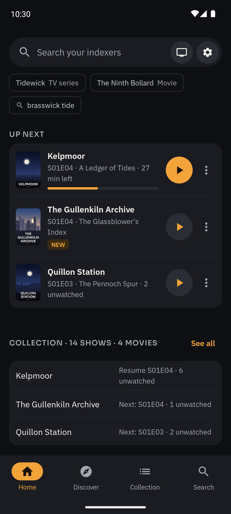
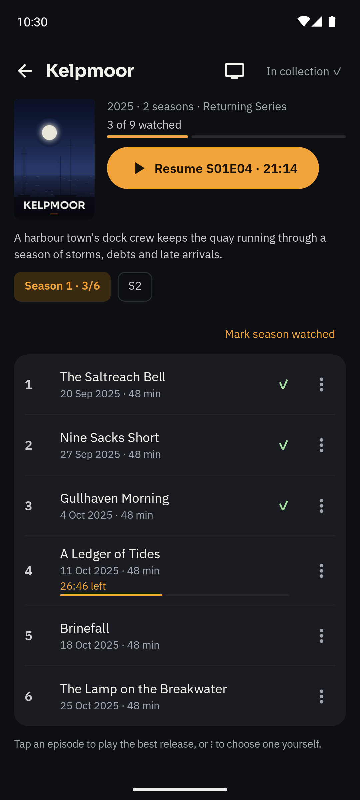
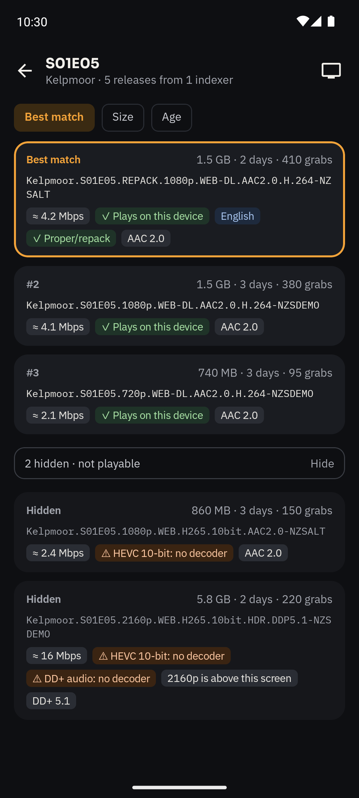
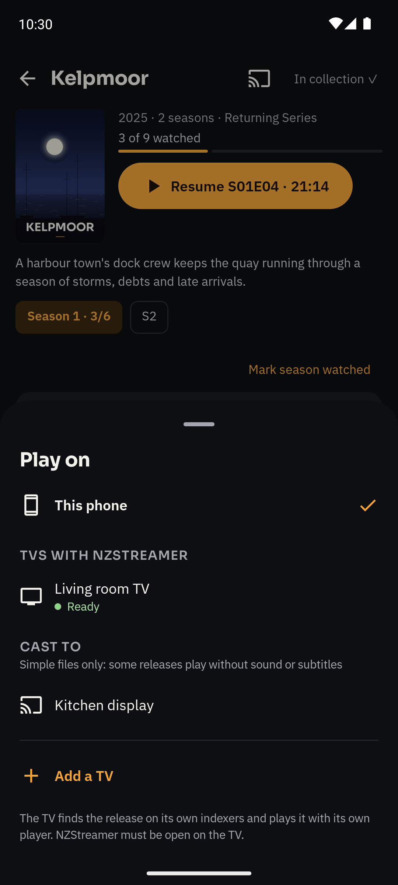
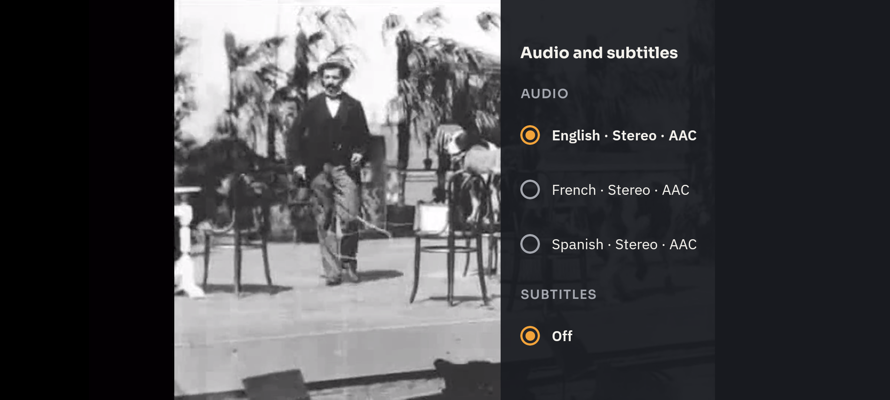
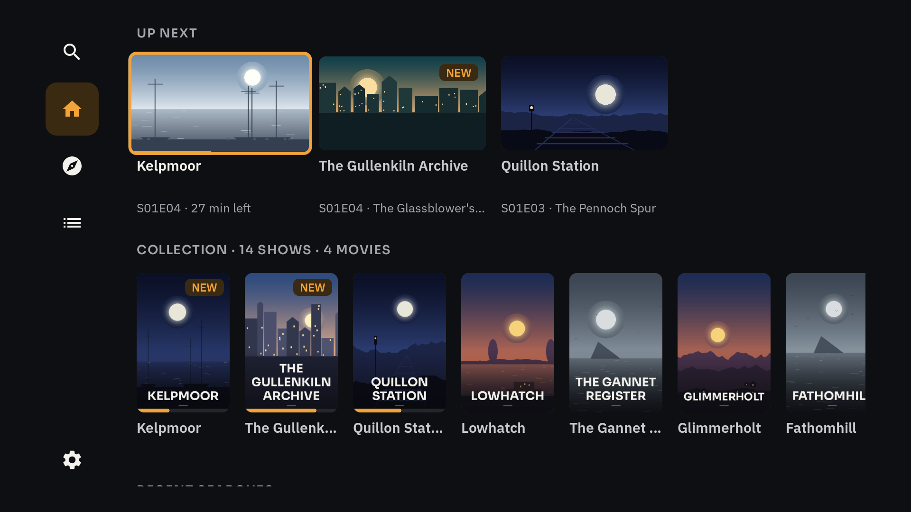
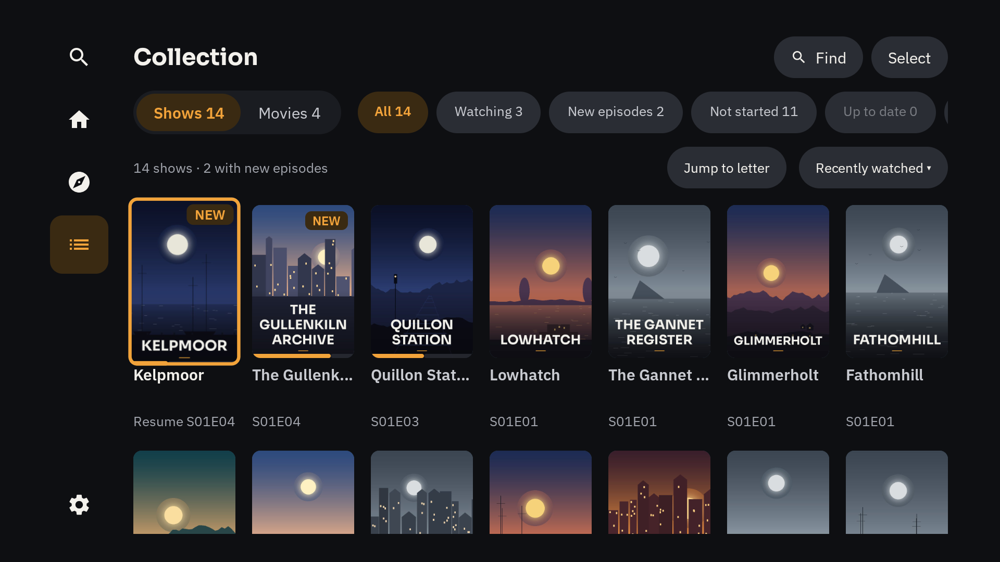
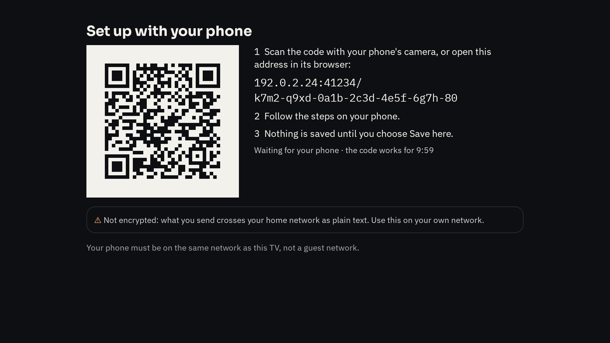

<h1 align="center">
  <picture>
    <source media="(prefers-color-scheme: dark)" srcset=".github/readme/logo-on-dark.png">
    
  </picture>
</h1>

<p align="center">
  <a href="https://github.com/skjaere/nzstreamer/actions/workflows/ci.yml"></a>
  <a href="https://codecov.io/gh/skjaere/nzstreamer"></a>
  <a href="https://github.com/skjaere/nzstreamer/releases"></a>
  <a href="LICENSE.md"></a>
</p>

NZStreamer plays video from Usenet on Android phones, tablets and TVs. It streams straight from your own Usenet
provider, using NZBs from your own indexers: nothing is downloaded first. It comes with no providers, indexers or
content of its own.

## What it does

### Streaming
- Streams NZB releases over NNTP while they play, with yEnc decoding in native code.
- Plays files inside uncompressed RAR (4 and 5) and 7-Zip volumes, also when the set is packed inside another (RAR
  volumes inside RAR, 7-Zip inside RAR, RAR inside 7-Zip), and finds obfuscated file names through PAR2.
- Several providers in your order: articles missing on one are fetched from the next.
- Searches your Newznab indexers together.
- Opens `.nzb` files from your device or from other apps, and asks for an archive's password when one needs it.
- Optional check of every article before a release starts.

### Finding what to play
- Title suggestions as you type, with your own TMDB API key; search by show, season and episode, or by movie.
  Without a key you can still search by name and open NZB files.
- Finds an episode inside a season pack when it has no release of its own. A pasted release name finds that release.
- Ranks releases for the device in your hand: its decoders, HDR and Dolby Vision support, the screen's resolution,
  your preferred quality, audio languages and maximum bitrate. Each release says why it ranked where it did.
- Tries the next release when one is incomplete or fails, up to a number you choose, or lets you choose one yourself.
- Voice search on TVs that have a speech recognizer.

### Library
- A collection of shows and movies, with filters, sorting and A–Z jump, and watched state per episode and movie.
- Up next on Home: resume, the next episode, new episodes.
- Posters and stills from TMDB, which you can turn off.

### Player
- Audio and subtitle choices remembered per show; preferred audio languages; subtitles when the audio isn't your
  first language; forced subtitles.
- Skip intro and recap from the file's chapters; optional intro and credits times from TheIntroDB (off by default:
  see Privacy).
- Next-episode card and autoplay; previous and next episode.
- File details: codecs, HDR and Dolby Vision profile, bitrate.
- Says when the stream is slower than the video needs, and asks what to do when a release turns out to miss parts.
- Phones: picture-in-picture, double-tap to seek, fit, fill and zoom.
- TVs: switches the TV to the video's frame rate (optional), and seeks faster while a remote key is held.

### Phones and TVs together
- Play on TV: pair your phone with your TV on your home network by matching numbers, start plays on the TV from the
  phone, and use the phone as its remote. Each device keeps its own accounts and keys.
- Set up with your phone: the TV shows a QR code, and you enter providers, indexers and the TMDB key in your phone's
  browser, over your home network.
- Google Cast: cast to Cast devices; the phone streams to the device over your home network, and releases are picked
  for what the device can play, with an optional maximum bitrate for casting. Cast stays off until you choose
  "Look for Cast devices". Subtitles don't show on a cast yet.

### Privacy
- No account, analytics, ads or server of its own. Passwords and keys are stored encrypted with the Android Keystore.
  Logs leave the device only when you share them.
- What leaves the device goes to your own providers, indexers and services, to TMDB with your own key, to TheIntroDB
  while its switch is on, and to Google while its Cast software runs. Settings › Privacy in the app says what each one
  gets.
- TheIntroDB is off by default, because turning it on tells a third party what you watch. With its switch on, each
  episode you start sends TheIntroDB the show's TMDB id, the season and episode, and the file's length, from your
  internet address. Its terms say it keeps internet addresses for up to 30 days, so together that is a record of the
  episodes watched from your connection. Films, release names and your providers or indexers are never sent to it.

### Not in every build
- Discover: TMDB's lists of shows and movies (trending, popular, top rated, airing, upcoming and more), filtered by
  genre and original language, and movies by year and streaming service. Debug, beta and bench (`-PbenchBuild=true`)
  builds have it; release builds leave it out.
- Debrid services: the code for playing through a debrid service (TorBox or Premiumize, with your own Torznab indexers
  in Prowlarr or Jackett) is in this repository. Beta builds hide it unless built with `-PwithDebrid=true`; other
  builds show it unless built with `-PhideDebrid=true`.

### Requirements
Android 8.0 (API 26) or later: phones, tablets, Android TV / Google TV, and Fire TV with Fire OS 7 or later (not Vega
OS). arm64-v8a, armeabi-v7a or x86_64.
English only for now.

## Screenshots

On a phone:

<p>
  
  
  
  
</p>
<p>
  
</p>

On a TV:

<p>
  
  
  
  
</p>

The shows, films, posters and releases in these screenshots are made up for them, and the video frames come from a
public-domain film of the 1890s. `tools/screens` makes them.

## Install

Each release has one APK, `NZStreamer.apk`, for phones, tablets and TVs. This address always gets the newest release's
APK:

```
https://github.com/skjaere/nzstreamer/releases/latest/download/NZStreamer.apk
```

It installs as NZStreamer Beta (`app.nzstreamer.beta`). Discover is in it, and debrid is hidden. It needs Android 8.0
or newer.

### Phones and tablets
1. Open the address above in the phone's browser, or tap `NZStreamer.apk` on
   [the latest release's page](https://github.com/skjaere/nzstreamer/releases/latest).
2. Open the download. The first time, Android sends you to Install unknown apps for the browser (or the files app you
   opened it from): allow it, go back, and tap Install.

If the browser warns about the file, choose Download anyway. If Play Protect blocks the install, choose More details,
then Install anyway.

### TVs
Fire TV needs Fire OS 7 or newer, which Settings, My Fire TV, About shows as its software version. A Fire TV that runs
Vega OS (About shows its software as OS, not Fire OS) installs apps from the
Amazon Appstore alone, so it can't install NZStreamer. On a smart TV with Fire TV built in, My Fire TV is called Device
& Software.

1. On Google TV and Fire TV, turn on the TV's developer options first. On Google TV: Settings, System, About, then
   select Android TV OS build until it says you are a developer. On Fire TV: Settings, My Fire TV, About, then select
   the first item, the device's name, about seven times; Developer Options shows one menu back.
2. Install Downloader by AFTVnews: from Google Play on Android TV and Google TV, from the Amazon Appstore on Fire TV.
   On Fire TV, then allow it under Settings, My Fire TV, Developer Options, Install unknown apps.
3. Open Downloader and type the code `4890122` into its text field: Downloader's short code for the address above. The
   address itself works too.
4. Let Downloader install unknown apps, then choose Install. On Android TV and Google TV, choose Settings in the message
   that comes up after the download, and set Downloader to Allowed.

If Downloader says Unknown Sources is disabled in place of that message, the developer options aren't on: do step 1,
then download again. If Play Protect blocks the install, choose Details, then Install anyway.

### Staying up to date
Obtainium installs apps from their releases and keeps them up to date. Get it from its GitHub releases, F-Droid or
IzzyOnDroid. It runs on TVs too: in Downloader, type the code `4982362`, Downloader's short code for this address,
which gets the APK of Obtainium's newest release that runs on every device:

```
https://github.com/ImranR98/Obtainium/releases/latest/download/app-release.apk
```

On Fire TV, also allow Obtainium under Settings, My Fire TV, Developer Options, Install unknown apps: it installs apps
itself.

1. In Obtainium, choose Add App. Type `nzstreamer` in the field labelled Search (some sources only), search, and pick
   skjaere/nzstreamer from GitHub's results. Or type the repository's address, `github.com/skjaere/nzstreamer`:
   Obtainium adds the `https://` itself.
2. Install NZStreamer from Obtainium. If you installed it from the browser or Downloader already, keep it: removing it
   would remove its settings. Obtainium asks you to confirm its first update, as it didn't install the version you have.

Obtainium then checks for new releases in the background. On Android 12 and newer it installs them in the background
too, as long as it installed the version you have and its background updates are on. On older Android it tells you
about a new release, and you confirm the install. Fire OS 7 and 8 are Android 9 to 11, so on them you always confirm.
On a TV the notice may not pop up: open Obtainium to see new releases, or on Fire TV look under Settings,
Notifications.

### Checking the APK
Every release is signed with one key, whose certificate's SHA-256 digest is in
[`tools/beta-cert.sha256`](tools/beta-cert.sha256). On a computer with Java and the Android SDK's build-tools, in the
folder that holds `NZStreamer.apk` and the release's `NZStreamer.apk.sha256`:

```sh
sha256sum -c NZStreamer.apk.sha256
"$ANDROID_HOME"/build-tools/<version>/apksigner verify --print-certs NZStreamer.apk
```

The first says the download is whole. On macOS it is `shasum -a 256 -c NZStreamer.apk.sha256`. On Windows,
`certutil -hashfile NZStreamer.apk SHA256` prints the download's digest, which must be the one in
`NZStreamer.apk.sha256`. The second runs apksigner from one of the SDK's build-tools folders (on Windows,
`%ANDROID_HOME%\build-tools\<version>\apksigner.bat`), as it isn't on the path. In what it prints, each line with
`certificate SHA-256 digest:` in it must end in the digest that `tools/beta-cert.sha256` holds. Newer build-tools print
one such line for each signature scheme; a second signer would show a second digest.

On a phone with Android 9 or newer, AppVerifier (from Accrescent, which needs Android 10, or from AppVerifier's GitHub
releases) shows an installed app's package name and signing certificate digest: they must be `app.nzstreamer.beta` and
the digest in `tools/beta-cert.sha256`. AppVerifier writes the digest in capitals, with a colon between each pair of
digits.

## Getting a TMDB key

A TMDB key is optional, but the collection, posters, episode lists and title suggestions need one. It's free, and
each user brings their own.

1. Create an account on [themoviedb.org](https://www.themoviedb.org/signup) and confirm your e-mail address.
2. Open [Settings, API](https://www.themoviedb.org/settings/api) and request an API key. Choose personal use, accept
   TMDB's terms, and fill in the short form: an application name, a URL and a summary. For example: NZStreamer,
   `https://github.com/skjaere/nzstreamer`, and "For NZStreamer on my own devices".
3. The same page then shows an API Key and an API Read Access Token. NZStreamer takes either.
4. In NZStreamer, open Settings › Metadata, paste the key into "TMDB API key or read access token", and choose Check
   and save. On a TV, choose Set up with your phone there and paste the key in your phone's browser instead of typing
   it with the remote.

TMDB's [getting started page](https://developer.themoviedb.org/docs/getting-started) has the same steps.

## Building from source

You need:
- JDK 17 as `JAVA_HOME`. Gradle 8.14 runs on JDK 17 to 24, not on 25.
- The Android SDK as `ANDROID_HOME`, with these packages:
  ```sh
  sdkmanager "platforms;android-36" "build-tools;35.0.0" "ndk;27.1.12297006" "cmake;3.22.1"
  ```
  The checks read the release dex with build-tools' `dexdump`.
- The rapidyenc submodule (`third_party/rapidyenc`), which the NDK builds into the app.

```sh
git clone --recurse-submodules https://github.com/skjaere/nzstreamer.git
cd nzstreamer
./gradlew :app:assembleDebug
```

In a clone made without `--recurse-submodules`, run `git submodule update --init` first. The debug APK lands in
`app/build/outputs/apk/debug/`. No `local.properties` is needed.

### The usenet libraries
The app is built on four libraries:
[nzb-streamer](https://github.com/skjaere/nzb-streamer),
[ktor-nntp-client](https://github.com/skjaere/ktor-nntp-client),
[rapidyenc-kotlin-wrapper](https://github.com/skjaere/rapidyenc-kotlin-wrapper) and
[kotlin-compression-utils](https://github.com/skjaere/kotlin-compression-utils).
By default Gradle takes their releases from JitPack, at the versions pinned in `gradle/libs.versions.toml`. JitPack
builds a version the first time anyone asks for it, so a first build can wait a few minutes.

To build against your own checkouts of them instead, name the folder that holds the four:

```sh
./gradlew -PusenetLibsDir=<folder> :app:assembleDebug
```

The folder holds `nzb-streamer`, `ktor-nntp-client`, `kotlin-compression-utils` and the wrapper, named
`rapidyenc-kotlin-wrapper` or `yenc_kotlin_wrapper` (with both there, the first is used, as `ktor-nntp-client`'s own
build uses it). The build fails when one of them is missing or holds no Gradle build.

### A mirror of Google's Maven repository
If `dl.google.com` can't be reached from your network, set a mirror in `~/.gradle/gradle.properties`:

```
googleMavenMirror=<mirror URL>
```

The mirror then replaces Google's repository. Gradle stops resolving at a repository that times out, so the two
can't be combined.

### Debug builds and your own accounts
On its first start, a debug build saves the mock NNTP server below as its provider (`10.0.2.2:1119`, TLS off). To
start one with your own accounts instead, add them to `local.properties`, which git ignores:

```
devProvider.host=news.example.com
devProvider.port=563
devProvider.username=...
devProvider.password=...
devProvider.tls=true
devProvider.connections=8
devIndexer.1.url=https://indexer.example/api
devIndexer.1.apikey=...
devTmdbKey=...
```

The comment at the top of `app/build.gradle.kts` lists every such setting. They are compiled into the debug APK, never
into a release build, so don't share a debug APK built with them.

## Tests

```sh
./gradlew check
```

`check` runs the unit tests and lint, and these checks of the built app, of the release build unless said otherwise:
- `:app:checkMinApi`: no io.skjaere code in the release dex uses a JDK API that minSdk devices lack. Known safe uses
  go in `app/min-api-allowlist.txt`.
- `:app:checkMinApiDiscover`: the same for Discover's code, read from the debug build's dex, as the release build
  leaves Discover out.
- `:app:checkNativeLibs` and `:app:checkBundleNativeLibs`: the APK and the App Bundle carry a native library for
  each of the three ABIs, with no debug sections, and 64-bit ones with 16 KB alignment.
- `:app:checkTvManifest`: the merged manifest keeps the app on TVs and in the TV launcher.
- `:app:checkNoDiscover`: the release build carries no Discover code, words or resources.
- `:app:checkCastStartsLate`: nothing in the merged manifests starts Google's Cast software without the app's gate.
- Lint's TV checks are errors. `app/lint-baseline.xml` holds the issues there were when they were turned on, so
  only new ones fail.

Each unit test has 2 minutes and each test task 15 minutes, in every module (the root `build.gradle.kts` sets both). A
test that hangs fails with its name and its thread's stack, and the tests after it still run. For a test in
`runBlocking`, that stack ends at its `runBlocking` line, not at the call the coroutine waits in. The test's limit is
off while a debugger is attached. A test task stopped at its limit writes no report, and the log names the tests it was
running, as skipped. The runs against a device, a TV or an account that a `-P` property turns on (`serveSpike`,
`serveProbe`, `debridLive` and `linkPeer`) have neither limit: they take as long as they need.

`./gradlew :koverXmlReportUnitTests` writes the coverage of the JVM unit tests of the app and of every `core` and
`tools` module to one report, `build/reports/kover/reportUnitTests.xml`. For an Android module it takes the debug
build's tests. CI sends the report to Codecov when the repository has a `CODECOV_TOKEN` secret.

### Device tests
Instrumented tests run on an emulator or a device: `./gradlew :app:connectedDebugAndroidTest`. The tests that stream
need the mock NNTP server, reachable from the emulator at `10.0.2.2:1119`, with test media seeded into it by
`tools/mock-seed`. The tests are written against [mock-nntp-server](https://github.com/skjaere/mock-nntp-server) 0.2.1,
the release built on the same library releases as the app's pins; its image carries that version as its tag. From the
repository's top folder:

```sh
docker run -d --rm --name mock-nntp -p 1119:1119 -p 8081:8081 ghcr.io/skjaere/mock-nntp-server:0.2.1
mkdir -p build/smoke
ffmpeg -f lavfi -i testsrc=duration=90:size=1280x720:rate=30 -f lavfi -i sine=frequency=440:duration=90 \
  -c:v libx264 -profile:v high -pix_fmt yuv420p -b:v 1M -c:a aac -shortest build/sample.mkv
./gradlew :tools:mock-seed:run --args="seed --video build/sample.mkv --out build/sample.nzb"
./gradlew :tools:mock-seed:run --args="verify --nzb build/sample.nzb --video build/sample.mkv"
cp build/sample.nzb build/sample.mkv build/smoke/
./gradlew :app:connectedDebugAndroidTest
```

The end-to-end smoke test (`EngineSmokeTest`) streams the clip through the `.nzb` that the build packs from
`build/smoke/`. Without those two files it is skipped, not run.

Article ids come from the file's contents, so seeding the same file again after a restart of the mock keeps its
`.nzb` valid. The fixtures under `app/src/androidTest/` are seeded the same way, for example
`./gradlew :tools:mock-seed:run --args="seed --video app/src/androidTest/fixtures/chapters.mkv --out build/chapters.nzb --segment 100000"`.

The fake indexer seeds an invented show and movie into the mock and serves them as a Newznab indexer; it prints its
address and API key. It needs a second clip too, a copy with E-AC-3 audio that one of its releases plays. Make it once:

```sh
ffmpeg -i build/sample.mkv -c:v copy -c:a eac3 build/sample-eac3.mkv
./gradlew :tools:mock-seed:run --args="indexer"
```

The other commands are listed in `tools/mock-seed/src/main/kotlin/io/skjaere/usenet/mockseed/Main.kt`.

## Licence

NZStreamer's own code is under the [PolyForm Noncommercial License 1.0.0](LICENSE.md) (SPDX
`PolyForm-Noncommercial-1.0.0`): free for any noncommercial use; commercial use needs the licensor's permission.
Fonts, icons and other third-party material keep their own licences: see
[THIRD_PARTY_NOTICES.md](THIRD_PARTY_NOTICES.md).

Required Notice: Copyright 2026 skjaere (https://github.com/skjaere)

Show and movie data, posters and stills come from [TMDB](https://www.themoviedb.org), with your own API key. This
product uses the TMDB API but is not endorsed or certified by TMDB.

Intro and credits times, when you turn them on, come from [TheIntroDB](https://theintrodb.org).

## Contributing

Pull requests are welcome once you have signed the [contributor licence agreement](CLA.md): see
[CONTRIBUTING.md](CONTRIBUTING.md).